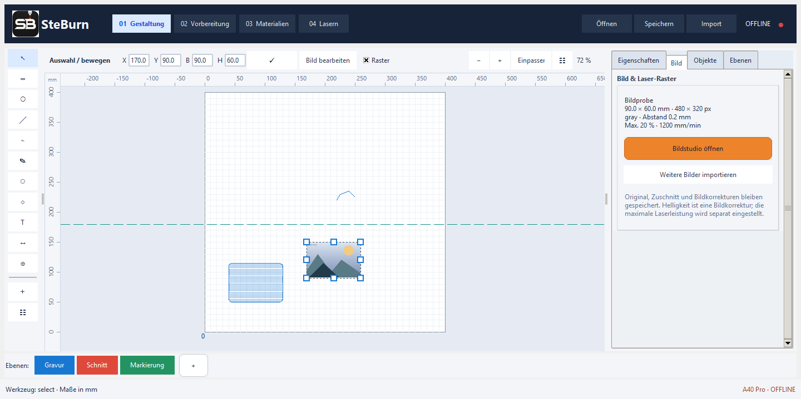

# SteBurn 0.11.1 · Konturen, Messung und Ebenenfolge

Windows-Editor und Lasersteuerung für Atomstack A40 Pro (400 × 400 mm, GRBL 1.1).

SteBurn verbindet Vektorgestaltung, Bildaufbereitung, Materialtests, Bahnsimulation und GRBL-Geräteansteuerung. Beiträge und Verbesserungsideen aus der Community sind willkommen: siehe [CONTRIBUTING.md](CONTRIBUTING.md).

**Entwicklungsstand:** SteBurn steuert reale Hardware. Vor Maschinenbetrieb die dokumentierten Voraussetzungen und Schutzmaßnahmen prüfen; Simulation und automatische Tests ersetzen keine Prüfung am Gerät.

## Neu in 0.11.1

- Ein Fangrahmen im Knotenmodus erfasst Endpunkte auch von vorher nicht ausgewählten Konturen. Die Endpunktauswahl bleibt beim anschließenden Verbinden erhalten.
- Die Auswahlreihenfolge bestimmt die Basis. Der erste Endpunkt wird als „1 · Basis“ markiert. Bei gemeinsamer Rahmenauswahl hat eine vorher ausgewählte Kontur Vorrang; ohne vorherige Auswahl entscheidet die Nähe zum Rahmenstart.
- Verbinden übernimmt Kennung, Name, Ebene und Bearbeitungswerte der Basis. Die neue Kontur erhält eine Gruppenkennung; vorhandene Gruppen beider Teile werden zusammengeführt. Strg+Z stellt die ursprünglichen Teile und Gruppen wieder her.

## Neu in 0.11

- Markierte Knoten gemeinsam verschieben oder mit Entf/„Löschen“ entfernen. Geschlossene Konturen bleiben geschlossen; werden zu wenige Knoten übrig gelassen, entfällt die betreffende Kontur. Strg+Z stellt sie wieder her.
- Gerade Linien besitzen ausschließlich zwei Endpunktgriffe, ohne Auswahlkasten oder Drehgriff. Endpunkte direkt ziehen. „Fangen“ bevorzugt den nächsten vorhandenen Punkt im Umkreis von 10 Bildschirmpixeln, danach das Raster; Alt setzt das Fangen vorübergehend aus.
- Offene Konturen mit Gerade, Kurve oder tangentialer Kurve verbinden, über „Verbinden“ im Knotenmodus, den Pfade-Bereich oder das Kontextmenü. Tangentialbedingungen sind an den Übergängen als T markiert, bleiben bei Griffänderungen erhalten und lassen sich wieder lösen.
- Nummerierte Ebenenfolge und ↑/↓ in Vorbereitung, Simulation und Cockpit. Änderungen berechnen den Plan neu und gelten für den nächsten Start. Während eines Geräteauftrags bleibt die Reihenfolge gesperrt.
- Scrollleisten rechts erscheinen nur, wenn der Inhalt die sichtbare Höhe übersteigt.
- Messen zeigt vom ersten Klick an Linie und Länge live. Zweiter Klick speichert das Maß; weitere Messungen sind unmittelbar möglich. „Alle Maße entfernen“ löscht die Bemaßungen. Maße bleiben im Projekt gespeichert und werden nicht gelasert.

Bedienung: [Konturen, Messung und Ebenenfolge 0.11](docs/KONTUREN-MESSEN-0.11.md).

## Neu in 0.10

- Seitliche Größenanfasser ändern ausschließlich Breite oder Höhe. Die Seitenverhältnis-Sperre gilt für die Eckanfasser.
- Knoten von Rechtecken, Ellipsen und Pfaden direkt bearbeiten. Mehrfachauswahl per Fangrahmen oder Shift/Strg; ausgewählte Knoten gemeinsam verschieben und über die äußeren orangefarbenen Griffe strecken beziehungsweise stauchen. Geschlossene Konturen und innere Konturen bleiben verbunden; primitive Formen werden erst beim Bearbeiten zu Pfaden.
- Linien und Ellipsen erhalten passende Zeichenvorschauen. Vielecke zeigen die gestrichelte Verbindung zur Maus vor dem nächsten Klick. Bézierkurven zeigen Kontrollpolygon und die entstehende Kurve; der Fehler beim Abschluss des vierten Punkts wurde behoben. Geschlossene Bézier-Anker halten die Naht und beide angrenzenden Tangenten zusammen.
- Ebenen entfernen über „−“ oder Rechtsklick auf den Farbreiter beziehungsweise die Ebenenauswahl. Vorhandene Objekte und deren Bearbeitungswerte werden auf die benachbarte Ebene übertragen. Entfernen lässt sich rückgängig machen; die letzte Ebene bleibt erhalten.

Bedienung: [Zeichnen und Knoten 0.10](docs/ZEICHNEN-0.10.md).

## Neu in 0.9.2

- Rahmenstopp wird im seriellen Steuerungsablauf einmalig gesendet und durch zwei stabile Stillstandsmeldungen bestätigt. Wiederholtes Rahmenfahren und anschließender Jobstart sind ohne neue Referenzfahrt im simulierten Ablauf geprüft; echte Alarme, Reset oder Kommunikationsverlust heben die Referenz weiterhin auf. Diagnoseprotokolle unter `user-data/device-traces` halten Ursache und Controllerantworten fest.
- Mausfahrt/Pointer unter Vorbereitung und im Materialtest unter „Position auf Werkstück“. Klick fährt direkt zum Ziel. Optionales Pointerlicht: standardmäßig aus, 0,1 %, maximal 0,5 %, als 0,15-s-Impuls am Ziel. Auch geringe Leistung kann markieren.
- Neue Prüfmuster beschriften mit konstanter Leistung, Vorgabe 20 % / 600 mm/min. „Nur Beschriftung testen“ öffnet einen gesonderten Auftrag ohne Matrixfelder; Werte materialabhängig vorab prüfen. „Zuordnung als Bild …“ exportiert Feldkennungen und Testwerte auch für ältere, unbeschriftete Proben.

## Neu in 0.9.1

- Materialtest im Reiter „Position auf Werkstück“ mit der Maus platzieren, X/Y direkt eingeben und Testfläche rahmenfahren. Werkstückmaße dienen als Orientierung. Der Maschinennullpunkt bleibt erhalten.
- Testgröße von 50 bis 300 mm, größere durchgehende Beschriftungsziffern sowie separat einstellbare Beschriftungsleistung und -geschwindigkeit. Historische Prüfmuster bleiben ladbar.
- Cockpit zeigt Startfehler mit Ursache und konkreter Abhilfe im Fenster, im Ereignisprotokoll und bei fehlgeschlagenen Aufträgen im Jobbericht. Direkter Weg zu „05 Gerät / Verbindung“.

## Neu in 0.9

- Vorbereitung: optionales Rahmenlicht, standardmäßig aus, mit 0,1 % vorbelegt und auf 0,5 % begrenzt. Auch schwaches Laserlicht kann Spuren erzeugen; spurenfreies Anzeigen ist nicht garantiert. Anfahrt und Stillstand bleiben ohne Strahl.
- Cockpit: Plus/Minus statt Schiebereglern, Vorschub in 250-mm/min-Schritten und absolute Leistung in 5-Prozentpunkt-Schritten. Änderungen werden sofort angefordert. Controllerannahme und Bestätigung im Bahnablauf werden getrennt angezeigt; bereits gepufferte Bewegung kann kurz nachlaufen.
- Statistik: Parameteränderungen mit Zeitpunkten und Bestätigungsstatus, zusätzlich dauerhaft gespeicherte JSON-Jobberichte.
- Materialien → Materialtest: wiederholbares 50 × 50-mm-Prüfmuster mit 15 Schnitt- und 15 Gravurfeldern, fünf Leistungen und jeweils drei Vorschüben. Eigenständiger Testjob mit festgelegten Matrixwerten; das aktuelle Projekt bleibt erhalten. Gemessene Tiefe, Durchtrennung und Qualität je Feld erfassen, als CSV exportieren und geeignete Werte als Materialprofil speichern.

Bedienung und Prüfumfang: [Materialtests und Liveparameter 0.9](docs/MATERIALTEST-0.9.md).

## Neu in 0.8

- Gepuffertes GRBL-Streaming statt vollständigem Stillstand nach jedem Liniensegment. Schnitt verwendet konstante Leistung (M3), Gravur dynamische Leistung (M4); Leerwege bleiben aus.
- Nach regulärem Ende Rückfahrt auf 0/0 mit ausgeschaltetem Laser. „Abbrechen + Referenzposition“ hält kontrolliert an und referenziert anschließend automatisch. Notstopp/Alarm/Kommunikationsfehler starten keine automatische Fahrt.
- Rahmenstopp über Jog-Cancel mit bestätigter Position, ohne Referenzverlust. „Neu referenzieren“ arbeitet auf derselben offenen Verbindung; Hintergrundabfragen blockieren den Button nicht mehr.
- „04 Lasern“ öffnet das eingepasste, maximierte Cockpit. Verbindung, Referenzierung und Diagnose liegen unter „05 Gerät“. Rahmenvorschau entfernt.
- Cockpit: Geschwindigkeit in mm/s, Leistung absolut 0–100 %, Ausgangswerte aus dem Plan. Änderungen wirken automatisch in folgenden Bahnabschnitten. Pause/Fortsetzen ist ein umschaltender Button.
- Jobstatistik mit Zeit, Pausen, Fahrweg und geschätzter Energie. Für Joule/Wh unter Gerät die optische Nennleistung in Watt eintragen; dies ist keine elektrische Verbrauchsmessung.
- Automatische Übernahme gültiger Änderungen an Text, Maßen, Ebenen, Bearbeitung, Radien und Knoten. Ein Klick auf einen Farbreiter weist ausgewählte Objekte direkt dessen Schnitt-/Gravur-/Markierungswerten zu.

Details und Prüfumfang: [Livebetrieb 0.8](docs/LIVEBETRIEB-0.8.md).

Neue Projektdateien verwenden Format 4, um Schnitt-, Gravur- und Markierungsoperationen auf Ebenen eindeutig zu speichern. Formate 1–3 bleiben lesbar. Ältere Programmversionen können Format 4 nicht öffnen.

## Start

Das Repository herunterladen oder klonen und entpacken. Python 3.11 oder neuer mit Tcl/Tk und Python-Launcher installieren. Zuerst `Einrichten-Steburn.bat` ausführen; dabei werden eine lokale Python-Umgebung und die Abhängigkeiten eingerichtet. Anschließend `Start-Steburn.bat` starten.

Persönliche Einstellungen, Materialprofile und Geräteprotokolle unter `user-data` sowie erzeugte Dateien unter `output` bleiben lokal und werden nicht mit Git veröffentlicht.

## Lizenz und Community

Copyright (C) 2026 Stefan231278 und Mitwirkende. SteBurn wird unter der **GNU Affero General Public License, Version 3 (AGPL-3.0-only)** veröffentlicht. Den vollständigen Lizenztext enthält [LICENSE](LICENSE). Es besteht keine Gewährleistung; Einzelheiten stehen im Lizenztext.

Fehler und Verbesserungsideen können über die [GitHub-Issues](https://github.com/Stefan231278/SteBurn/issues) gemeldet werden. Für eigene Änderungen bitte den [Beitragsleitfaden](CONTRIBUTING.md) beachten. Beiträge werden unter derselben Projektlizenz eingereicht. Abhängigkeiten behalten ihre jeweiligen Lizenzen; insbesondere wird PyMuPDF in seiner AGPL-Ausgabe verwendet.

## Neu in 0.7

**Werkzeugsymbole (0.7.2):** Einheitliche, geglättete Icons ersetzen die Schriftzeichen in der linken Leiste. Größere Bildflächen, dezente Akzentfarben, klare Gruppen und eine eigene Hervorhebung des aktiven Werkzeugs. Die Symbole passen sich dem Hell-/Dunkelmodus an; Tooltips und Werkzeugfunktionen bleiben erhalten.

**Darkmode (0.7.1):** Oben über „Dunkel/Hell“ oder unter Ansicht → Dunkle Darstellung umschalten. Die Auswahl wird in `user-data/settings.json` gespeichert. Zeichenfläche, Lineale, Eingabefelder, Seitenleisten, Bildstudio, Vorbereitung, Simulation und Cockpit erhalten passende dunkle Farben. Zeichnungsfarben und Bildpixel bleiben unverändert. Bei der ersten Verwendung ist Dunkel voreingestellt.

Der Zeichenbereich ist an GIMP/Inkscape angelehnt: schmale Werkzeugleiste, kontextabhängige Optionen, Lineale, Hilfslinien, Rasterfang, einblendbare Eigenschaften und Objektliste. Tab blendet die Seitenleiste ein/aus; Leertaste + Ziehen verschiebt die Ansicht, Strg + Scrollen zoomt. Vektorobjekte besitzen einen Drehgriff, Freihandlinien lassen sich mit einstellbarer Vereinfachung zeichnen.

Der Import öffnet Bilder im **Bildstudio**: mehrere Dateien, Original-/Laserbild-Vergleich, Helligkeit, Kontrast, Gamma, Schärfe, Schwarz-/Weißpunkt, automatische Tonwerte, Negativ, Zuschnitt, Drehung und Spiegelung. Zur Ausgabe stehen Graustufen, Floyd-Steinberg, Atkinson und Schwellwert zur Wahl. Maße, Rasterabstand, maximale Leistung, Vorschub und Durchgänge sind getrennt einstellbar.

Originale und Korrekturen bleiben im Projekt gespeichert. Vorschau und Laserplan verwenden dieselbe Bildberechnung; Größenänderungen werden für den Plan aus dem Original neu gerastert. Das bestehende Segmentlimit bleibt bestehen und wird im Bildstudio berücksichtigt. SVG/DXF/PDF und die bisherigen Importformate bleiben verfügbar.

Bedienung: [Design & Bildstudio 0.7](docs/DESIGN-BILDSTUDIO-0.7.md).

## Arbeitsbereiche seit 0.6

Vier Arbeitsbereiche führen durch den Ablauf: **Gestaltung → Vorbereitung → Materialien → Lasern**.

- Gestaltung: eigene Gruppen für Formen, Knoten, Text und Maße. Rechteckradien, editierbare kubische Bézierkurven mit Tangentengriffen, formtreues Segmentteilen, Knotenpositionen und Knotenlöschen.
- Text: mehrzeiliger Inhalt, Systemschriften und Schriftschnitte, Schriftgröße, Laufweite in mm, Zeilenabstand und links-/mittel-/rechtsbündiger Satz. Text bleibt editierbar oder lässt sich in Pfade umwandeln.
- Vorbereitung: gemeinsame Werkzeugwegübersicht, Prüfung der Ausgabeebenen, Planhinweise, Bahnsimulation und reale Rahmenfahrt. Ein eigener Button öffnet das Job-Cockpit.
- Materialien: eigene Bibliotheksansicht mit Material, Stärke, Bearbeitungsart, Vorschub, Leistung, Durchgängen und Linienabstand. Profile sind projektübergreifend verfügbar und werden bei Verwendung zusätzlich im Projekt gespeichert.
- Job-Cockpit: Live-Position, Controllerzustand, Vorschub, S-Leistungswert, Werkzeugweg, abgeschlossene Segmente, Zeiten und Ereignisse. Vorschub- und Leistungs-Overrides während des Laufs einstellen und anwenden; Pause, Fortsetzen und Reset bleiben erhalten.

Bedienung und Grenzen: [Studio 0.6](docs/STUDIO-0.6.md).

## Verbindung und Livebetrieb seit 0.5

- Touchpad mit zwei Fingern: Arbeitsfläche verschieben; Strg + Scrollen zoomt, Shift + Scrollen verschiebt horizontal. Seitenleisten verarbeiten kleine Scrollschritte auch über Eingabefeldern.
- Maximierter Start und kompakte Eingabezeilen. Auf dem geprüften Bildschirm passen alle fünf Hauptregister ohne vertikales Scrollen. Bei kleineren Fenstern bleiben Scrollleisten verfügbar; Nebenaktionen stehen unter „Mehr“.
- Kleiner Verbindungspunkt oben rechts: Grün bei bestätigter Kommunikation, sonst Rot. Leerlaufprüfung alle zwei Sekunden.
- COM5 / 115200 voreingestellt. **Verbinden + Referenzfahrt startet unmittelbar eine reale Referenzfahrt.** Anschließend werden G54 und G92 auf Nullversatz gesetzt und geprüft; kein separater Freigabedialog.
- Rahmen fährt wiederholt um den gesamten Begrenzungsbereich der Auswahl, sonst der Ausgabeobjekte. Der Strahl bleibt standardmäßig aus; seit 0.9 ist schwaches Rahmenlicht zuschaltbar. Seit 0.8 stoppt „Rahmen stoppen“ positionsbewahrend per Jog-Cancel.
- „Lasern“ öffnet das Auftragsfenster. „Auftrag starten · Lasern“ startet mit den gespeicherten Werten. Seit 0.8: M3 für Schnitt, M4 für Gravur, Leerfahrten S0, Abschluss M5 und Rückfahrt auf 0/0. Pause/Fortsetzen und absolute Live-Parameter bleiben verfügbar.
- Geräteantworten und Fehler stehen im Status; keine zusätzlichen Antwortfenster oder routinemäßigen Bestätigungsdialoge. Dateiauswahl und Schutz ungespeicherter Projekte bleiben erhalten.

Details: [Livebetrieb 0.5](docs/LIVETEST-0.5.md).

## Voraussetzungen für Maschinenaufträge

Andere Programme müssen COM5 freigeben. SteBurn prüft Homing, Nullpunkt, $20/$21/$22=1, $13=0, $32=1, gültiges $30 und passende Arbeitsflächenparameter. Diese Firmwareparameter werden nicht automatisch geändert. Der vorhandene Randabstand von 5 mm bleibt bestehen.

Reset, Alarm oder Kommunikationsfehler heben die Positionsfreigabe auf. Jeder neue Verbindungsaufbau referenziert erneut. Das Öffnen von SteBurn oder der Auftragsansicht allein spricht die Maschine nicht an.

Auftragspläne sind unveränderliche Schnappschüsse. Seit 0.8 werden kurze Bahnabschnitte kontinuierlich gepuffert übertragen. Zeitschätzungen berücksichtigen Beschleunigung und Übertragungsverzögerungen nicht vollständig. Während physischer Aufträge wird Windows wach gehalten; niedriger Akku fordert Pause an. Wiederaufnahme ab einer Prozentzahl bleibt ausschließlich eine Vorschau.

## Editor und Module

Projektformat `.steburn` (Schema 4; Schema 1–3 lesbar), Vektor-/Bildimport, Objekt- und Ebenenparameter, Kontur-/Flächenbearbeitung, Simulation, Materialvorlagen, Relief-Assistent und parametrischer Boxengenerator.

- [Boxen und Gehäuse](docs/BOXEN.md)
- [Importformate](docs/IMPORTFORMATE.md)
- [Historische Beschreibung 0.4](docs/README-0.4.md) – die dortigen Maschinenfreigaben und Bedienabläufe wurden durch 0.5 ersetzt.

## Prüfung

203 automatische Tests bestanden. GUI-Prüfungen decken Fangrahmen um unselektierte Endpunkte, chronologische Basiswahl, Parameterübernahme, Gruppenzusammenführung und Undo ab. Weiterhin geprüft: Knotenbearbeitung, tangentiale Verbindungen, Live-Bemaßung, Scrollleisten und Ebenenfolge. Keine reale Laserbewegung oder Materialbearbeitung während dieser Entwicklungsprüfung.

Tests: `python -m unittest discover -s tests -p "test_*.py"`

GUI für 0.11.1: `python tests/gui_join_selection.py`. Weitere Prüfungen: `python tests/gui_geometry_workflow.py`, `python tests/gui_drawing.py`, `python tests/gui_calibration.py`, `python tests/gui_live_edits.py`, `python tests/gui_workspace.py` und `python tests/gui_studio.py`.
